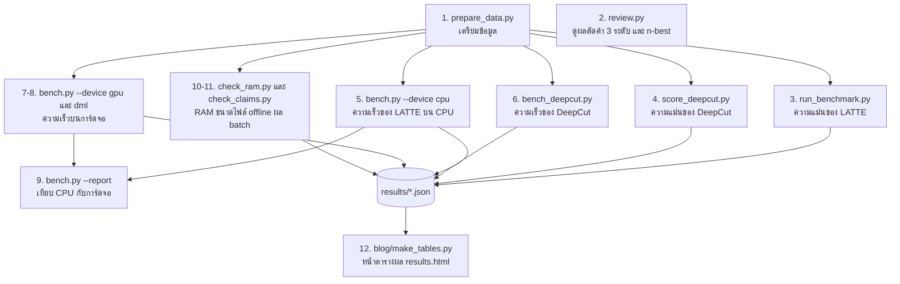

# ขั้นตอนการทดลอง (Workflow)

เอกสารนี้อธิบายการทดลองทีละขั้น: แต่ละขั้นทำอะไร ใช้คำสั่งอะไร อ่านและเขียนไฟล์ไหน และควรได้ผลประมาณเท่าไร
ก่อนเริ่มต้องสร้าง environment ตามหัวข้อ "การติดตั้ง" ใน [README](../README.md) ให้เรียบร้อย

ทุกคำสั่งรันจากโฟลเดอร์หลักของ repo ตัวเลขในหัวข้อ "ผลที่ควรได้" มาจากการรันบนเครื่องที่ใช้ทดสอบ
(AMD Ryzen 7 5700G, RTX 3080, Windows 11) คะแนนความแม่นควรได้เท่ากันทุกเครื่อง ส่วนเวลาจะต่างไปตามเครื่อง

## ภาพรวม



`review.py` ไม่ต้องใช้ข้อมูลจากขั้นที่ 1 จึงรันเมื่อไรก็ได้ ขั้นที่ 3 ถึง 11 ไม่ขึ้นต่อกัน ยกเว้นขั้นที่ 9 ซึ่งต้องมีผลของ CPU
และการ์ดจออย่างน้อยหนึ่งแบบก่อน

## หลักที่ใช้ตลอดการทดลอง

- **CPU 1 thread** ทุกการจับเวลา ตามเงื่อนไขของผู้พัฒนา
- **ข้อความเดียวกัน** การจับเวลาทุกรายการใช้ `data/corpus_1m.txt` (1,000,019 ตัวอักษร)
- **ข้อมูลที่แจกต่อได้และมีเฉลยจากคนเท่านั้น** ไม่โหลด BEST, ORCHID และชุดทดสอบของ khammoon
- **อย่ารันงานอื่นระหว่างจับเวลา** การจับเวลาสองรายการพร้อมกันทำให้ตัวเลขเพี้ยน ให้รันทีละรายการ
- **ผลอยู่ใน `results/`** สคริปต์หนึ่งตัวเขียนไฟล์ผลของตัวเองหนึ่งไฟล์ การรันซ้ำจะเขียนทับไฟล์เดิม

## ขั้นที่ 1: เตรียมข้อมูล

```powershell
.venv\Scripts\python.exe -X utf8 prepare_data.py
```

| | |
|---|---|
| ทำอะไร | โหลดไฟล์ของ benchmark ที่เราใช้ สร้างข้อความจับเวลา และแปลง TALPCo เป็นชุดทดสอบ |
| โหลดจาก | Hugging Face (`iapp/OpenThai2.0-WordSeg-Benchmark`) และ GitHub (`matbahasa/TALPCo`) โดยระบุ revision ตายตัว |
| เขียน | `wordseg-bench/` (ตัวคิดคะแนน คะแนนที่เผยแพร่ ชุดทดสอบ 4 ชุด), `data/corpus_1m.txt`, `data/talpco/`, `data/talpco_tha.jsonl` |
| ขนาดที่โหลด | ราว 16 MB |

ผลที่ควรได้

```text
2) ข้อความจับเวลา
  3,591 บรรทัด 1,000,019 ตัวอักษร -> data\corpus_1m.txt
3) TALPCo ภาษาไทย
  1,368 ประโยค 10,923 คำ -> data\talpco_tha.jsonl
  ข้าม 4 ประโยคที่คำไม่ตรงกับประโยคดิบ: 1553, 1826, 1919, 3327
```

ทุกไฟล์ถูกตรวจ SHA-256 ถ้าไม่ตรงสคริปต์จะหยุดและไม่ใช้ไฟล์นั้น ไฟล์ที่มีอยู่แล้วและถูกต้องจะไม่ถูกโหลดซ้ำ
รันคำสั่งนี้ซ้ำได้โดยไม่เสียหาย

## ขั้นที่ 2: ดูผลตัดคำ 3 ระดับ และ n-best

```powershell
.venv\Scripts\python.exe -X utf8 review.py
```

| | |
|---|---|
| ทำอะไร | ตัดประโยคตัวอย่าง 6 ประโยคด้วยทั้ง 3 ระดับ และขอ 3 คำตอบแรกของข้อความกำกวม 5 ข้อความ |
| เขียน | ไม่เขียนไฟล์ พิมพ์ผลอย่างเดียว |

ผลที่ควรได้ (บางส่วน)

```text
  ร้านอาหารตามสั่งหน้าปากซอยอร่อยมาก
    long     ( 6 ชิ้น)  ร้านอาหาร | ตามสั่ง | หน้า | ปากซอย | อร่อย | มาก
    short    ( 8 ชิ้น)  ร้าน | อาหาร | ตามสั่ง | หน้า | ปาก | ซอย | อร่อย | มาก
    minimal  ( 9 ชิ้น)  ร้าน | อาหาร | ตาม | สั่ง | หน้า | ปาก | ซอย | อร่อย | มาก

  ตากลม
    1.  41.8%  ตา | กลม
    2.  41.4%  ตากลม
    3.   8.3%  ตาก | ลม
```

ถ้าจะลองประโยคของตัวเอง แก้รายการ `SENTENCES` และ `AMBIGUOUS` ที่หัวไฟล์

## ขั้นที่ 3: ความแม่นของ LATTE

```powershell
.venv\Scripts\python.exe -X utf8 run_benchmark.py                # ทั้ง 3 ระดับ ราว 3.5 นาที
.venv\Scripts\python.exe -X utf8 run_benchmark.py --unit short   # ระดับเดียว
```

| | |
|---|---|
| ทำอะไร | เรียก tokenizer ทีละบรรทัดบนชุดทดสอบ 4 ชุดของ benchmark และ TALPCo แล้วคิด word F1 ด้วยตัวคิดคะแนนของ benchmark |
| อ่าน | `wordseg-bench/data/*.jsonl`, `data/talpco_tha.jsonl`, `wordseg-bench/results/expected.json` |
| เขียน | `results/f1.json` |

ผลที่ควรได้ (word F1)

| ชุดทดสอบ | long | short | minimal |
|---|---:|---:|---:|
| TUD | 83.69 | 90.23 | 85.36 |
| PUD | 86.20 | 84.64 | 80.35 |
| Wisesight-160 | 85.69 | 88.53 | 84.04 |
| VISTEC | 92.73 | 87.90 | 76.47 |
| เฉลี่ย 4 ชุด | 87.08 | 87.82 | 81.56 |
| TALPCo | 88.69 | 92.96 | 92.15 |

คะแนนไม่เปลี่ยนเมื่อรันซ้ำ เพราะการเรียกทีละบรรทัดได้ผลตัดคำเหมือนเดิมทุกครั้ง
ท้ายผลจะพิมพ์ค่าเฉลี่ยของเราเรียงรวมกับระบบอื่นที่ผู้พัฒนา benchmark เผยแพร่ไว้

## ขั้นที่ 4: ความแม่นของ DeepCut

```powershell
.venv-deepcut\Scripts\python.exe -X utf8 score_deepcut.py                 # ราว 2.5 นาที
.venv-deepcut\Scripts\python.exe -X utf8 score_deepcut.py --sets vistec   # ชุดใหญ่ ราว 20 นาที (ไม่บังคับ)
```

| | |
|---|---|
| ทำอะไร | วัด DeepCut ด้วยวิธีเดียวกับขั้นที่ 3 เพื่อใช้เป็นตัวเทียบบน TALPCo และตรวจว่า DeepCut ที่ติดตั้งทำงานเหมือนของผู้พัฒนา |
| อ่าน | ชุดทดสอบเดียวกับขั้นที่ 3 |
| เขียน | `results/f1_deepcut.json` |

ผลที่ควรได้

| ชุดทดสอบ | เราวัดได้ | ผู้พัฒนาเผยแพร่ |
|---|---:|---:|
| TALPCo | 91.80 | ไม่มี |
| TUD | 85.50 | 85.50 |
| PUD | 85.62 | 85.62 |
| Wisesight-160 | 83.13 | 83.13 |

## ขั้นที่ 5: ความเร็วของ LATTE บน CPU

```powershell
.venv\Scripts\python.exe -X utf8 bench.py --device cpu                  # ราว 4 นาที
.venv\Scripts\python.exe -X utf8 bench.py --device cpu --chars 100000   # ลองเร็ว ๆ ไม่บันทึกผล
```

| | |
|---|---|
| ทำอะไร | จับเวลาตัดข้อความ 1 ล้านตัวอักษร 4 แบบ: เรียกทีละบรรทัด และส่งเป็น batch 3 ขนาด แต่ละแบบรัน 3 ครั้งแล้วเก็บครั้งที่เร็วที่สุด |
| อ่าน | `data/corpus_1m.txt` |
| เขียน | `results/cpu.json`, `results/cpu.tokens.txt` |

ผลที่ควรได้บนเครื่องที่ใช้ทดสอบ

```text
ทีละบรรทัด                   19.93 วินาที       50,166 ตัวอักษร/วินาที
batch 4,096 ตัวอักษร         17.27 วินาที       57,907 ตัวอักษร/วินาที
batch 32,768 ตัวอักษร        17.86 วินาที       55,991 ตัวอักษร/วินาที
batch 131,072 ตัวอักษร       18.48 วินาที       54,103 ตัวอักษร/วินาที
```

ตัวเลขต่างกันระหว่างรอบได้ราว 3–7%

## ขั้นที่ 6: ความเร็วของ DeepCut

```powershell
.venv-deepcut\Scripts\python.exe -X utf8 bench_deepcut.py                 # ราว 6.5 นาที
.venv-deepcut\Scripts\python.exe -X utf8 bench_deepcut.py --chars 20000   # ลองเร็ว ๆ ไม่บันทึกผล
```

| | |
|---|---|
| ทำอะไร | จับเวลา DeepCut แบบเรียกทีละบรรทัดบนข้อความเดียวกัน โดยบังคับให้ใช้ CPU 1 thread |
| อ่าน | `data/corpus_1m.txt` และ `results/cpu.json` (ถ้ามี ใช้พิมพ์ว่า LATTE เร็วกว่ากี่เท่า) |
| เขียน | `results/deepcut.json` |

ผลที่ควรได้: ราว 379 วินาที หรือ 2,636 ตัวอักษรต่อวินาที ซึ่งใกล้กับ 2,576 ที่ผู้พัฒนารายงาน
เพื่อให้อัตราส่วนเทียบกันได้ตรงที่สุด ควรรันขั้นที่ 5 กับขั้นที่ 6 ต่อเนื่องกันในสภาพเครื่องเดียวกัน

## ขั้นที่ 7 และ 8: ความเร็วบนการ์ดจอ

```powershell
.venv-gpu12\Scripts\python.exe -X utf8 bench.py --device gpu   # CUDA 12 ราว 4.5 นาที
.venv-dml\Scripts\python.exe -X utf8 bench.py --device dml     # DirectML ราว 5 นาที
```

| | |
|---|---|
| ทำอะไร | รัน model เดียวกันโดยให้ ONNX Runtime ใช้การ์ดจอก่อน CPU จับเวลา 4 แบบเหมือนขั้นที่ 5 แล้วดูว่า node ของ model ไปรันที่ไหน |
| อ่าน | `data/corpus_1m.txt` |
| เขียน | `results/gpu.json`, `results/gpu.tokens.txt` หรือ `results/dml.json`, `results/dml.tokens.txt` |

ผลที่ควรได้บนเครื่องที่ใช้ทดสอบ

| วิธีเรียก | CUDA | DirectML |
|---|---:|---:|
| ทีละบรรทัด | 34.9 วินาที | 41.3 วินาที |
| batch 4,096 | 16.4 วินาที | 18.8 วินาที |
| batch 32,768 | 14.7 วินาที | 18.1 วินาที |
| batch 131,072 | 15.0 วินาที | 17.1 วินาที |

```text
node ของ model ไปรันที่ไหน:
  CUDAExecutionProvider     38 node      96.9 ms
  CPUExecutionProvider       5 node     657.3 ms
```

ตัวเลขฝั่งการ์ดจอแกว่งระหว่างรอบได้ราว 15% ส่วนที่ค้างบน CPU คือชั้น LSTM แบบ INT8 ซึ่งไม่มีตัวรันบนการ์ดจอ

สคริปต์จะหยุดและไม่บันทึกผล ถ้าพบว่า ONNX Runtime ถอยไปรันบน CPU ดูหัวข้อ "ปัญหาที่เคยเจอ" ด้านล่าง

## ขั้นที่ 9: เทียบ CPU กับการ์ดจอ

```powershell
.venv\Scripts\python.exe -X utf8 bench.py --report
```

| | |
|---|---|
| ทำอะไร | อ่านผลของ CPU และการ์ดจอที่บันทึกไว้ พิมพ์ตาราง Markdown เทียบเวลา สัดส่วนบรรทัดที่ตัดเหมือนกัน และ node ที่รันบนแต่ละฝั่ง |
| อ่าน | `results/cpu.json`, `results/gpu.json`, `results/dml.json` และไฟล์ `.tokens.txt` ของแต่ละตัว |
| เขียน | ไม่เขียนไฟล์ |

ผลที่ควรได้ (บางส่วน)

```text
| ทีละบรรทัด | 19.9 | 34.9 | 50,166 | 28,639 | ช้ากว่า 1.75 เท่า |
ผลตัดคำเหมือนกับ CPU: 3,535 จาก 3,591 บรรทัด (98.4%)
```

## ขั้นที่ 10: หน่วยความจำ

```powershell
.venv\Scripts\python.exe -X utf8 check_ram.py
```

| | |
|---|---|
| ทำอะไร | วัด RAM ของ 3 แบบการใช้งาน โดยรันแต่ละแบบใน process ใหม่เพื่อไม่ให้ค่าสูงสุดปนกัน |
| อ่าน | `data/corpus_1m.txt` |
| เขียน | `results/ram.json` |

ผลที่ควรได้: หลังโหลด model ราว 79 MB สูงสุดราว 97 MB เมื่อเรียกทีละบรรทัด และราว 216 MB เมื่อส่ง 1 ล้านตัวอักษรในครั้งเดียว

## ขั้นที่ 11: ขนาดไฟล์ การรัน offline และผล batch

```powershell
.venv\Scripts\python.exe -X utf8 check_claims.py
```

| | |
|---|---|
| ทำอะไร | ดูขนาดไฟล์ model ที่ติดตั้งมา ปิดเครือข่ายของ process แล้วลองตัดคำ และนับบรรทัดที่การส่งเป็น batch ตัดต่างจากการเรียกทีละบรรทัด |
| อ่าน | ไฟล์ model ใน package และ `data/corpus_1m.txt` |
| เขียน | `results/claims.json` |

ผลที่ควรได้

```text
   model กับ dictionary  3.82 MB
2) รันได้เมื่อปิดเครือข่าย: ได้
3) batch ตัดต่างจากทีละบรรทัด 105 จาก 3,591 บรรทัด (2.92%)
   เรียกทีละบรรทัดซ้ำได้ผลเหมือนเดิม: ใช่
```

## ขั้นที่ 12: สร้างหน้าตารางผล

```powershell
.venv\Scripts\python.exe -X utf8 blog\make_tables.py
```

| | |
|---|---|
| ทำอะไร | สร้าง `blog/results.html` ซึ่งรวมผลทั้งหมด 18 ตาราง แต่ละตารางคัดลอกเป็นตารางจริงหรือเป็น Markdown ได้ |
| อ่าน | เนื้อหาของตารางที่เขียนไว้ใน `blog/make_tables.py` เอง |
| เขียน | `blog/results.html` |

ตัวเลขในตารางคัดมาจากไฟล์ผลด้วยมือ สคริปต์นี้ไม่ได้อ่าน `results/` เอง ดูหัวข้อถัดไป

## เมื่อรันใหม่แล้วตัวเลขเปลี่ยน

ตัวเลขในสามที่ต่อไปนี้เขียนด้วยมือ จึงต้องแก้ให้ตรงกับไฟล์ผลชุดใหม่

1. ตารางใน `blog/make_tables.py` (แต่ละตารางมี comment บอกว่ามาจากไฟล์ผลไหน) แล้วรันขั้นที่ 12
2. ตารางใน `README.md`
3. หัวข้อ "ผลที่ควรได้" ในเอกสารนี้

## การเก็บผลหลายรอบ

`bench.py` เขียนทับ `results/<device>.json` ทุกครั้งที่รัน ถ้าต้องการเก็บผลรอบก่อนไว้ดูความแกว่ง
ให้คัดลอกไฟล์ไปชื่ออื่นก่อนรันรอบใหม่ ไฟล์ที่เก็บไว้ใน repo นี้คือ

| ไฟล์ | รอบ | สภาพเครื่องตอนวัด |
|---|---|---|
| `cpu_run1.json` | CPU รอบ 1 | มีการติดตั้งโปรแกรมเดินอยู่ |
| `cpu_run2.json` | CPU รอบ 2 (วัดต่อจาก DeepCut ทันที ใช้ในตารางเทียบกับ DeepCut) | มีการดาวน์โหลดเดินอยู่ |
| `cpu.json` | CPU รอบ 3 (ใช้ในตารางเทียบกับการ์ดจอ) | เครื่องว่าง |
| `cpu_ort1244.json` | CPU รอบ 4 รันใน `.venv-gpu12` ซึ่งใช้ ONNX Runtime 1.24.4 | เครื่องว่าง |
| `gpu_run1.json` | CUDA รอบ 1 | เครื่องว่าง |
| `gpu.json` | CUDA รอบ 2 | เครื่องว่าง |
| `dml_run1.json` | DirectML รอบ 1 | มีการดาวน์โหลดเดินอยู่ |
| `dml.json` | DirectML รอบ 2 | เครื่องว่าง |

`cpu_ort1244.json` มีไว้ตอบว่ารุ่นของ ONNX Runtime ทำให้ผลต่างกันไหม คำตอบคือ ความเร็วบน CPU ต่างกันไม่เกิน 3%
และผลตัดคำเหมือนกันทุกบรรทัด ส่วนต่างระหว่าง CPU กับการ์ดจอจึงมาจากการ์ดจอ ไม่ใช่จากรุ่นของ ONNX Runtime

## ปัญหาที่เคยเจอ

| อาการ | สาเหตุ | วิธีแก้ |
|---|---|---|
| `การ์ดจอใช้ไม่ได้ ... ONNX Runtime ถอยไปใช้ ['CPUExecutionProvider']` พร้อม `CUDA failure 801` | driver ของการ์ดจอเก่ากว่าที่ชุด CUDA ต้องการ เช่น `onnxruntime-gpu` 1.32.0 ใช้ CUDA 13 แต่ driver 560.94 รองรับถึง CUDA 12.6 | ใช้ `onnxruntime-gpu` 1.24.4 ซึ่งใช้ CUDA 12 ตามหัวข้อการติดตั้ง หรืออัปเดต driver |
| ข้อความ `CUDNN_STATUS_SUBLIBRARY_LOADING_FAILED` หรือ `Could not locate cudnn_engines_tensor_ir64_9.dll` | ONNX Runtime รุ่นเก่าไม่โหลด DLL ทุกตัวของ cuDNN รุ่นใหม่ | `bench.py` เพิ่มโฟลเดอร์ของ package `nvidia-*` เข้า path ให้แล้ว ถ้าเขียนโค้ดเองต้องทำแบบเดียวกันก่อนสร้าง session |
| ได้เวลาของการ์ดจอใกล้กับ CPU ทุกแบบ | ONNX Runtime ถอยไปรันบน CPU โดยไม่หยุดโปรแกรม | ตรวจ `session.get_providers()` หลังรันจริง ไม่ใช่แค่ตอนสร้าง session (`bench.py` ตรวจให้แล้ว) |
| `SHA-256 ของ ... ไม่ตรง` ตอนเตรียมข้อมูล | ไฟล์โหลดมาไม่ครบ หรือต้นทางเปลี่ยน | รัน `prepare_data.py` ซ้ำ ถ้ายังไม่ตรงแปลว่าต้นทางเปลี่ยน ให้ตรวจก่อนแก้ค่าในสคริปต์ |
| ภาษาไทยในผลที่พิมพ์เป็นตัวประหลาด หรือ `UnicodeEncodeError` | console หรือ pipe ไม่ได้ใช้ UTF-8 | รันด้วย `python -X utf8` ตามตัวอย่างในเอกสารนี้ |
| DeepCut รันนานเกินไปสำหรับการลอง | DeepCut ช้ากว่า LATTE ราว 19 เท่า | ใช้ `--chars 20000` เพื่อลองกับข้อความบางส่วน |
